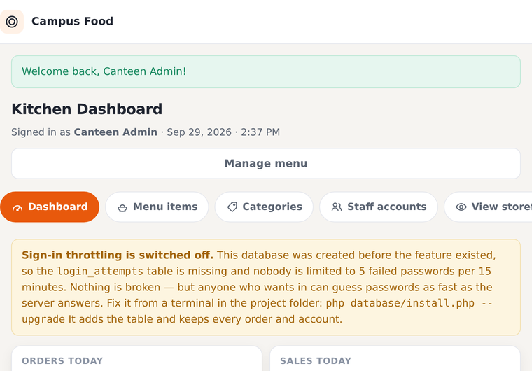
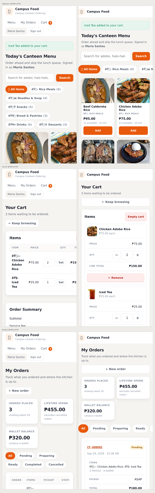
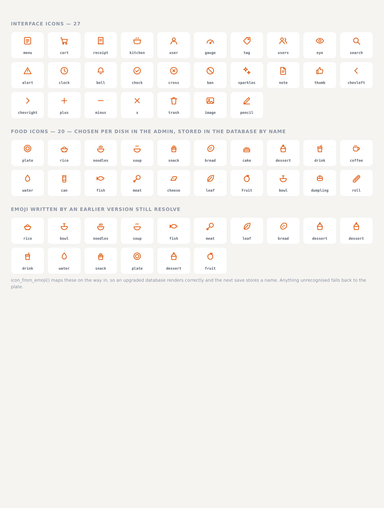
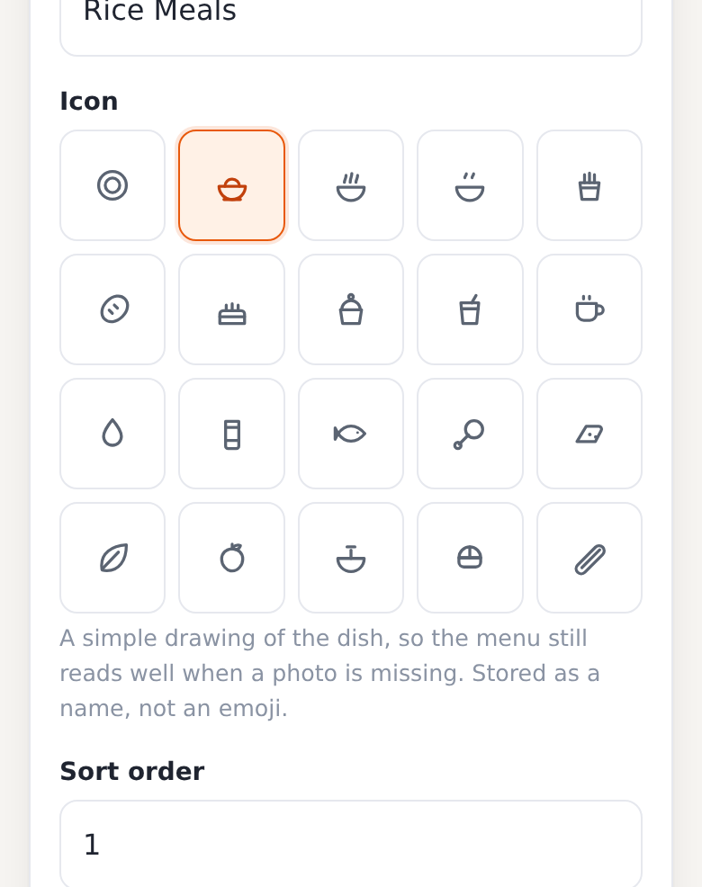

# 🍽️ Campus Food System

A small campus canteen ordering system built with **plain PHP** and **MariaDB**, talking to the
database through the **mysqli** extension. No frameworks, no Composer, no CDN — just copy the
folder into `htdocs` and it runs.

Students browse the menu, add food to a cart, choose a pickup time and place an order (paying cash
on pickup or from a campus e-wallet). Canteen staff see a live order board and move each order from
*pending* → *preparing* → *ready* → *completed*, while managing the menu and its stock.

---

## ⚠️ Demo data vs. a real canteen

This repo ships a **sample canteen** so you can see the app working immediately. That sample data
is for **demonstration only** — it is not something to put in front of paying students.

| | Demo install | Real canteen |
|---|---|---|
| Menu | 27 generic Filipino dishes | your actual menu |
| Photos | **Real** photographs from Wikimedia Commons (see below) | photos you take of your own cooking |
| Accounts | `admin@campus.edu` / `admin123` — publicly known | your own admin account |
| Flag | every row has `is_demo = 1` | your rows have `is_demo = 0` |

**Why the demo photos must not go live:** they are genuine photographs, but they show dishes cooked
somewhere else. A student who orders your adobo and receives something different has been misled.
`demo-data.sql` carries its own warning header saying exactly this.

**Going live in one click:** sign in as the admin, open **Admin → Menu items**, and press
**"Remove all demo data"**. That deletes every `is_demo` row, the sample orders, the sample
accounts' history and the downloaded stock photos — leaving an empty menu for you to fill with your
own dishes and your own photos. (The options above also explain how to start empty from the very
very beginning with `--no-seed`.)

Nothing in the app ever *creates* demo content: `schema.sql` makes an empty database, and only
`demo-data.sql` inserts samples. The admin's own "add item" form starts a dish with **no photo at
all**, so a real menu can never accidentally inherit a stock image.

---

## Setting up a real canteen (the part that matters)

Starting with **`schema.sql` only** — no demo data — gives you an empty database with **no accounts
at all**. That's the right starting point, but it raises a question the web app can't answer on its
own: how do you become the administrator?

**Register normally, then promote yourself from the command line:**

```bash
# 1. in the browser: register an account at /register.php
# 2. on the server:
php tools/make-admin.php --promote you@campus.edu
```

That's it — sign in and the admin pages are open. Run `php tools/make-admin.php --help` for the rest
(`--list` to see who exists, `--email` to create an admin directly, `--force` to reset a password).

> **Why a command-line script?** An endpoint that can create administrators is the most valuable
> thing on the server to an attacker, so it must never be reachable over the web. `tools/make-admin.php`
> refuses to run outside the terminal, and `.htaccess` blocks the whole `tools/` folder as a second
> layer. This is also your emergency way back in if you ever lose admin access.

Once you're in, **Admin → Staff accounts** handles the rest without any SQL:

| Task | How |
|---|---|
| Add a colleague as admin | *Add an administrator* form on the Staff page |
| Promote an existing student | **Make admin** on their row — keeps their orders and wallet |
| Retire someone | **Demote** (they can still order as a student) |
| Remove an ex-student | **Delete** — refused if they have order history, to protect your records |

**You cannot lock yourself out.** The last administrator cannot be demoted or deleted, and you can't
remove your own access. Both actions would leave nobody able to open the admin pages, and the only
way back would be the CLI.

### First-day checklist for a real canteen

1. `php database/install.php --no-seed` — empty database
2. Register yourself, then `php tools/make-admin.php --promote you@campus.edu`
3. **My Account → Change password** — pick your own, not a demo one
4. **Admin → Categories** — set up your real sections
5. **Admin → Menu items** — add your dishes and upload your own photos
6. **Admin → Staff accounts** — add anyone else who needs access
7. Check `config/db.php` uses a password-protected database user, not `root` with no password

### Changing your own password

Every signed-in user can update their name, student ID, phone number and password from
**My Account** (click your name in the top-right). Changing the password requires the current one,
rotates the session id so other devices are signed out, and — for the demo accounts — clears the
demo flag, because the published password is no longer in use.

### Giving this to somebody else

There are two downloads, because there are two audiences. Both are the same
code; they differ only in what they are allowed to hand a stranger.

| | demo | production |
|---|---|---|
| `database/demo-data.sql` | yes — 6 categories, 27 dishes, 3 accounts, 4 orders | no |
| dish photographs | 27 real Commons photos + thumbnails | none |
| accounts | three, with public passwords | none — yours |
| `APP_DEBUG` in the generated `.env` | on | off |
| size | 8.3 MB | 4.0 MB |

Both unpack to one `campus-food/` folder and carry a `WHERE-TO-START.txt`
at the top with the three commands that matter, plus a `MANIFEST.txt` listing
every file so a download can be checked without unzipping it.

Build them from the project you are reading:

```bash
tools/make-release.sh                 # both, into release/
tools/make-release.sh production      # or just one
VERSION=1.1 tools/make-release.sh
```

Then check the result the only way that proves anything — unpack it and run it:

```bash
tools/check-release.sh
```

That script unpacks each zip into a temp folder, installs a throwaway database,
starts a server on it and uses the app: it signs in, places an order, uploads a
photo, trips both sign-in throttle rules, registers a fresh account on the
production build and promotes it with `tools/make-admin.php`. It also compares
the two zips against what each is supposed to contain, and checks that neither
has picked up a `.env`, an error log or an uploaded photo. 66 checks; the demo
build additionally runs the whole of `tools/regression.sh` (43 more) against the
unpacked copy.

Neither zip contains `.env`, `storage/logs/`, `public/uploads/`, `public/_shot/`
or the development scripts (`shot.sh`, `mobile-audit.py`, and these two release
tools) — those live in the repository.

One thing worth knowing if you rename the database: `install.php` rewrites the
database name inside `schema.sql` and `demo-data.sql` to whatever `DB_NAME`
says, so a canteen configured as `canteen_north` gets exactly that and not a
second database called `campus_food`.

---

### Updating a canteen that is already running

`database/schema.sql` starts with `DROP DATABASE`. That is exactly right for a
fresh install and catastrophic for a database that already has orders in it, so
new tables are never added there. They go in `database/upgrade.sql`, which only
ever adds things:

```bash
php database/install.php --upgrade
```

It adds what is missing, prints the row counts before and after, and touches
nothing else. Run it every time you copy new code onto a working canteen.

If a database is missing something the app needs, the app keeps working and
says so on the dashboard — it never fails silently and never locks you out:



---

## Security

Everything here is something you can check on your own server, not a promise
in a paragraph. The short version: **the app assumes a hostile network** — a
campus wifi is one — and defends the account and the kitchen PC, not the
homework of whoever is attacking it.

### The session cookie

The cookie is called `campusfood_sid`, and it is set `HttpOnly; SameSite=Lax`
(plus `Secure` whenever the site is served over HTTPS):

- **HttpOnly** — JavaScript cannot read it, so a script that somehow gets into
  the page still cannot steal the session.
- **SameSite=Lax** — another site cannot make your browser send it, which is
  what stops cross-site request forgery from working at all.
- **Secure** — added automatically when the request arrives over HTTPS, so the
  cookie is never sent in the clear. On a plain-HTTP Termux demo it is left off
  on purpose; setting it there would break sign-in.
- Session ids are regenerated at sign-in, so a fixed id from before the login
  is worthless, and a session that sits idle for 8 hours expires.

### Sign-in throttling

Passwords are guessed by machines, so guesses are counted:

| Limit | Value | Stops |
|---|---|---|
| Per email | 5 failures / 15 min | guessing one person's password |
| Per address | 25 failures / 15 min | spraying one password across many accounts |

A blocked attempt is refused *before* any password work happens, so the
throttle cannot itself be used to burn CPU. Two details that matter: an email
nobody has registered still pays the full ~220 ms bcrypt cost, so the form
cannot be used to find out which addresses are real, and signing in
successfully clears that account's failures, so a student who finally
remembers their password is not left waiting.

If the `login_attempts` table is missing (an old database that has not been
upgraded), throttling switches itself off, writes one line to the log, and the
dashboard shows the warning above with the exact command to fix it.

### Errors, and what a stranger gets to see

In production the browser is shown a plain apology and nothing else. The real
detail — file paths, SQL, the line that failed — goes to
`storage/logs/app.log`, which sits **outside** the web root and is therefore
never downloadable. The folder has to be writable by the web server user:

```bash
chmod 755 storage/logs          # or chown it to the web server user
```

For development, `APP_DEBUG=1` puts the full detail back in the page. The
Termux starter writes that flag into its demo `.env` because seeing errors is
useful on your own phone; **delete that line on a real canteen.**

### Content Security Policy

Every page is sent with a policy that allows scripts from this site only:
`script-src 'self'`. There is no inline JavaScript anywhere in the project —
that is why the delete buttons carry `data-confirm="…"` instead of
`onsubmit="return confirm(…)`. All the behaviour lives in
`public/assets/app.js`. A policy like this is what makes an injected `<script>`
a dead end rather than a compromise.

One deliberate trade-off: the policy allows `'unsafe-inline'` for **styles**,
because the templates set around forty small `style=""` attributes (bar widths,
thumbnail sizes). Inline CSS cannot execute, so the exposure is cosmetic, while
inline *script* — the thing that actually matters — stays blocked. Removing it
would mean moving those values into classes, which is a fair job for whoever
wants the stricter header.

### Uploaded photographs

The only thing a canteen can put on the server is a photo, and `store_menu_photo()`
treats it as hostile:

- the real type is decided by `getimagesize()`, never by the filename or the
  browser's `Content-Type`;
- PNG, JPEG and WebP only, under 6 MB, at least 300×220;
- the image is **re-encoded through GD**, so EXIF and anything hidden in the
  file does not survive;
- it is saved under a name the app generates itself, so a crafted filename
  cannot climb out of the upload folder;
- `public/uploads/.htaccess` tells Apache never to execute anything in there,
  in case a script is ever planted.

Nothing else in the app writes to disk. And only `public/uploads/` is ever
deleted — the shipped demo photographs in `public/assets/menu/` are never
touched, which is the rule that keeps "clear the demo data" from eating real
files.

### What this does not do

Worth saying plainly, so nobody assumes more than is there:

- **No HTTPS of its own.** Termux and XAMPP serve plain HTTP. Behind a real
  domain, put it behind a reverse proxy or hosting control panel that does
  TLS — the app then adds the `Secure` cookie flag automatically.
- **No email verification and no password reset** — a canteen admin creates
  accounts. If you need either, that is the next feature to build.
- **No protection against someone at the keyboard of the kitchen PC.** The
  session is a browser session; lock the screen.
- **The demo passwords are public.** They are printed in this README and in
  the installer. Change them (My Account → Change password) before anyone
  else is on the network.

### Checking it yourself

`tools/regression.sh` runs the whole thing end to end against a running
server — headers and cookie flags, the cart maths, stock and wallet
bookkeeping, CSRF, photo uploads, and both throttling rules:

```bash
php -S 0.0.0.0:8000 -t public &
tools/regression.sh
```

It refuses to run unless the demo admin account is present, because it places
and cancels real orders — it is for the demo install, not for a live canteen.

---

## Mobile data matters here

The menu is the page students open most, usually on a phone. Photos are stored three ways so the
grid doesn't cost a fortune in data:

| Size | Where | Used for |
|---|---|---|
| ~1000px | `assets/menu/<dish>.jpg` | the original |
| **512px** | `assets/menu/thumbs/<dish>.jpg` | the menu card (about 42 KB) |
| **160px** | `assets/menu/thumbs/tiny/<dish>.jpg` | admin table rows (about 6 KB) |

An initial menu load went from **3.0 MB to 1.1 MB**; with lazy loading a phone on first paint pulls
roughly **8 photos, about 330 KB**. Thumbnails are written automatically when a canteen uploads a
dish photo, and `python3 tools/make-thumbs.py` backfills them for the demo set. If a thumbnail is
ever missing, PHP silently falls back to the full image, so nothing breaks. The generated sizes are
git-ignored build output — they can always be rebuilt from the originals.

**A rule worth knowing if you touch the photo code:** the app only ever deletes files under
`public/uploads/`, the folder it writes itself. The demo photographs in `assets/menu/` ship with the
project and are treated as read-only, so replacing a dish's stock photo leaves the original on disk —
a reinstall of the demo data still has images to show. The one action allowed to clear them is the
admin's explicit **Remove all demo data**.

---

## On a phone

Most students will only ever see this app on a phone, so the mobile layout is the real one —
not a shrunk desktop. Here is the same three pages either side of the pass
(`docs/mobile-before-after.png`):



**What changed**

| | Before | After |
|---|---|---|
| Header | 160 px of chrome before any food | **63 px**, navigation moved to a bottom tab bar |
| Categories | 4 wrapped rows (~250 px) | one swipeable row |
| Menu cards | 2-up but **overlapping** — cards were wider than their column | 2 clean columns, price and Add stacked, full-width thumb targets |
| Cart | a 5-column table crushed into 390 px, "Set" buttons 31 px tall | one card per item: thumbnail, price, stepper, remove |
| Orders | a 634 px table — you had to scroll sideways | one card per order, labelled fields |
| Tap targets | 16 controls under 44 px | **all ≥ 44 px** |
| Text inputs | 15 px — iOS zooms the page in on focus | 16 px, so it doesn't |

**Specifics worth knowing**

- **Bottom tab bar** (`.tabbar`, mobile only): Menu · Cart · Orders · Kitchen · Account,
  with a live cart count. It respects `env(safe-area-inset-bottom)` so it clears the
  home indicator on notched phones, and the page reserves matching space.
- **The quantity stepper needs no JavaScript.** `−` and `+` are two submit buttons
  posting `step=dec|inc`; typing a number submits on change. The server clamps to real
  stock and says why: *"The kitchen only has 21 left, so that is as many as you can order."*
  It works with scripts disabled, and the buttons are 44×44 for a thumb.
- **Wide tables become cards.** Add `table--stack` and a `data-label` per cell; on a phone
  each row becomes a card with the label beside its value. The markup stays a real
  `<table>`, so screen readers and the desktop layout are unaffected.
- **Two photo sizes per card.** `srcset` offers the 512 px thumb and the 160 px tiny one
  with `sizes="(max-width: 780px) 45vw, 232px"`, so a phone on a poor connection can take
  the 6 KB version.
- **Credit policy:** photo credits are hidden under 520 px, where they would sit three
  wrapped lines deep under a half-width card. Every credit is always in
  `assets/menu/credits.json`, and the desktop layout shows them on each card.

**Two development helpers** (CLI only, like the other tools):

```bash
tools/shot.sh index.php cart.php orders.php     # screenshots at a real 390 px viewport
tools/mobile-audit.py public/_shot/index.html   # measures overflow, tap targets, input sizes
```

Why a screenshot needs a tool at all: Chromium on Linux **refuses to make a window
narrower than 500 px**, so `--window-size=390` silently lays out at 500 px and crops it —
media queries fire at the wrong breakpoint and everything *looks* broken that isn't.
`shot.sh` renders each page inside a fixed-width iframe, which gives the document a
genuine 390 px viewport, then measures its height and crops precisely. It also checks
horizontal overflow, any tap target under 44 px, and any input under 16 px.

---

## Icons

Every icon in the app is **inline SVG, drawn in `includes/icons.php`** — not an emoji. The full set
is in `docs/icons.png` (also generated by that file, so it can never drift):



**Why not emoji.** An emoji is whatever font the viewer's device happens to have. The same dish
appears as a glossy Apple emoji, a flat Noto one, a monochrome glyph or an empty box — and a canteen
on an old Android phone sees something different again. Several of the emoji this project used to
ship (🍽️, 🏷️, 🥘) rendered as tofu boxes on common systems. SVG paths look the same everywhere,
take their colour from the text around them, and need no icon font, no build step and no CDN.

**How it works.** `icon_sprite()` prints every path once per page as a hidden `<symbol>` block;
`icon('cart', 20)` references one with `<use>`. That is one file to edit and no extra HTTP request.

```php
<?= icon('cart', 20) ?>                     // in a template
<?= icon('receipt', 20, '', 'Orders') ?>    // accessible name when there's no visible text
<?= item_icon($row['icon'], 20) ?>          // a value from the database
```

**The database stores names, not emoji.** The `icon` and `item_icon` columns hold `'rice'`,
`'noodles'`, `'drink'` — a name from `icon_paths()`. They were `VARCHAR(8)` in the original schema,
and every *storable* name fits inside that, so no migration is needed. (`chevright` is 9 characters
and therefore interface-only; `icon_clean()` refuses anything that wouldn't fit rather than letting
MySQL truncate it silently.)

**Upgrading an old database.** Rows written by the previous version hold an emoji. `icon_from_emoji()`
maps them on the way out — 🍗 becomes `meat`, 🥘 becomes `soup` — so an existing installation renders
correctly immediately, and the next time that row is saved it stores a name. Anything unrecognised
falls back to the plate.

**Choosing an icon** is a grid of radio buttons in the item and category editors, not a text field
where someone has to paste an emoji:



Each option is a real tap target on a phone (the name is hidden under 780px, where the drawing speaks
for itself), the current choice is highlighted, and it works with no JavaScript. In the menu grid the
dish icon is a *fallback*: any dish with a photo shows the photo, which is why the mobile layout
hides the icon tile when there's an image above it.

**Adding your own icon** is one line in `icon_paths()`: a 24×24 viewBox drawn with strokes, no fills,
simple enough to stay legible at 16px.

---

## About the photographs

The demo builds use **real photographs, not AI-generated images**. Every one is a genuine photo of
that dish, sourced from **Wikimedia Commons** under CC0, public domain, CC BY or CC BY-SA.

- See them all at once: **`docs/demo-menu-photos.png`** (proof sheet, grouped by category)
- Full manifest with author and licence: **`public/assets/menu/credits.json`**
- How they were fetched and vetted: **`tools/fetch-food-photos.py`**
- Attribution is stored per row in `image_credit` / `image_source` and, because CC BY and CC BY-SA
  *require* it, shown under each dish on the menu and in the admin editor.

`tools/fetch-food-photos.py` ranks candidates by relevance first and licence second — an early
version that weighted licences first happily picked a CC0 photo of **eggplant in cream of shrimp**
for *lechon kawali*, and for *halo-halo* it picked a photo of an **atmospheric sun halo**. It now
requires the dish name in the filename, filters scene photos and brand shots, and lets you pin an
exact Commons file when the search still gets it wrong. Please eyeball anything you add.

If you replace a demo photo with your own, the app clears that item's `image_credit`/`image_source`
at the same time: the attribution described the old image, and your own photo is yours.

---

## Features

**Student side**
- Browse the menu with category filters and a search box
- Real photographs on each dish, with the licence and photographer credited
- An icon per dish and per category — inline SVG, so it looks the same on every phone
- Cart stored in the PHP session; quantities capped at available stock
- Checkout with pickup time, notes for the kitchen, and cash or e-wallet payment
- Order history, plus a receipt page with a live status timeline
- Self-service cancellation of orders that haven't been cooked yet
- Own profile and password page — no admin needed to fix your own details
- Register / sign in / sign out

**Canteen admin side**
- Dashboard with today's orders, sales, live queue and low-stock watchlist
- Live kitchen board: one click to start cooking, mark ready, or mark collected
- Full menu CRUD — add, edit, delete items, change prices, restock, hide items
- Photo upload per dish (JPEG/PNG/WebP, validated and resized on the server)
- Icon picker for dishes and categories — a tap-through grid, no emoji to paste
- One-click **Remove all demo data** to clear the samples before going live
- Staff accounts: add admins, promote students, retire leavers, with
  lockout-proof guards around the last administrator
- Category management (create, rename, reorder, hide)
- Cancelling an order automatically returns the stock and refunds e-wallet payments

---

## Requirements

| Thing | Version |
|---|---|
| PHP | 8.0+ (developed on 8.4) |
| MariaDB | 10.4+ (or MySQL 5.7+) |
| PHP extensions | `mysqli` (required), `mbstring` (optional — falls back automatically), `gd` (for photo uploads; thumbnails are skipped without it) |

---

## Quick start

### Option A — Termux (Android, no computer needed)

Termux is a Linux terminal for Android, so you can run the whole thing on your phone.
There's a starter script that does every step for you.

```bash
# 1. copy the campus-food folder to your phone (git clone, or unzip into ~)
cd ~/campus-food

# 2. run it
chmod +x termux-start.sh
./termux-start.sh
```

That one command:

1. installs `php` and `mariadb` if they're missing
2. initialises the MariaDB data directory (first run only)
3. generates a random database password and saves it to `.env` (mode 600)
4. creates the database and imports the schema + sample data
5. starts MariaDB and the PHP server, then prints the URL

Open **http://localhost:8080** in your phone's browser. Press `Ctrl+C` to stop.

| Command | What it does |
|---|---|
| `./termux-start.sh` | install + run in the foreground (Ctrl+C stops everything) |
| `./termux-start.sh up` | run in the background and get your prompt back |
| `./termux-start.sh down` | stop the web server and MariaDB |
| `./termux-start.sh status` | are they running? how much data is in the database? |
| `./termux-start.sh logs` | tail the MariaDB and web server logs |
| `./termux-start.sh db` | open an interactive MariaDB shell on the database |
| `./termux-start.sh reset` | drop the database and re-import fresh sample data |
| `./termux-start.sh cred` | show the generated credentials in `.env` |
| `./termux-start.sh sql file.sql` | run your own SQL file |
| `./termux-start.sh --help` | all the flags |

Handy extras:

```bash
./termux-start.sh up --lan --port 8081   # reachable from other devices on your Wi-Fi
echo "alias campus='~/campus-food/termux-start.sh'" >> ~/.bashrc && source ~/.bashrc
campus up
```

**Termux gotchas that trip people up** (the script works around all of these):

- **You do *not* need `pkg install php-mysqli`.** Termux's `php` package is built with
  `--with-mysqli=mysqlnd` and `--enable-mbstring`, so mysqli is already there. Older forum posts
  and blog tutorials that tell you to install a mysqli package are out of date — there is no such
  package, and `pkg install php-mysqli` will just fail.
- **`localhost` can be a trap.** Termux compiles PHP with a default MySQL socket of
  `$PREFIX/tmp/mysqld.sock`, but the MariaDB server creates `$PREFIX/var/run/mysqld.sock`. Those
  paths don't match, so a connection to `localhost` can fail even while the server is running fine.
  The script always talks to `127.0.0.1` (TCP) instead.
- **Keep the project in `$HOME`**, not on `/sdcard`. PHP files and the built-in server can hit
  permission problems on shared storage.
- **MariaDB's root account starts with an empty password** on Termux (that's what the official
  package does). The app never uses root — it gets its own `campus` account with a random password.
  MariaDB is also bound to `127.0.0.1`, so nothing on the campus Wi-Fi can reach your database.
- **Android may kill the server when the screen sleeps.** Run `termux-wake-lock` before
  `./termux-start.sh up`, and `termux-wake-unlock` when you're done.

### Option B — XAMPP / WAMP / MAMP

1. Copy the `campus-food` folder into your web root
   (XAMPP on Windows: `C:\xampp\htdocs\campus-food`).
2. Start **Apache** and **MySQL/MariaDB** from the control panel.
3. Create the database. Open **phpMyAdmin** → *Import* → choose
   `database/schema.sql` → Go. Then import `database/seed.sql` the same way.
   *(Or from a terminal: `mysql -u root -p < database/schema.sql` then
   `mysql -u root -p campus_food < database/seed.sql`.)*
4. Visit **http://localhost/campus-food/public/**.

### Option C — PHP's built-in server (fastest, any Linux/macOS)

```bash
cd campus-food

# 1. create the database + sample data
mysql -u root -p < database/schema.sql
mysql -u root -p campus_food < database/demo-data.sql

# 2. serve the public/ folder
php -S localhost:8000 -t public
```

Then open <http://localhost:8000>.

### Creating the database with PHP instead

There is a small CLI installer that uses `mysqli::multi_query` to run the SQL files:

```bash
php database/install.php            # create DB + schema + DEMO data
php database/install.php --no-seed  # schema only, empty canteen  <- use for a real canteen
```

It is deliberately command-line only — an installer reachable from the browser would be a security
hole.

---

## Demo logins

| Role | Email | Password |
|---|---|---|
| Canteen admin | `admin@campus.edu` | `admin123` |
| Student | `maria@campus.edu` | `campus123` |
| Student | `juan@campus.edu` | `campus123` |

The two students start with ₱500 and ₱250 of e-wallet credit. The demo data also includes 27 menu
items across 6 categories and 4 past orders, so the dashboard isn't empty — every one of them
flagged `is_demo = 1` and removable in one click from the admin.

Real photographs are included for all 27 dishes (see *About the photographs* above).

---

## Pointing the web server at the right folder

> **The web root must be `public/`, not the project root.**

Everything outside `public/` is private code and SQL. If your `DocumentRoot` is the project root
instead, a visitor could download `database/schema.sql` or `config/db.php` as plain text.

If you must point at the project root (common on shared hosting), the bundled `.htaccess` blocks
access to `config/`, `includes/` and `database/`, and refuses to serve `.sql` files. You can also
uncomment the last two lines of that file to rewrite everything into `public/`.

---

## Project structure

```
campus-food/
├── config/
│   └── db.php                  # the ONLY file that knows the DB credentials
├── includes/
│   ├── functions.php           # helpers: queries, auth, cart, CSRF, formatting
│   ├── security.php            # session cookie, headers, error handler, throttle
│   ├── icons.php               # the SVG icon set: paths, sprite, picker
│   ├── header.php              # shared <head> + nav + flash messages
│   ├── footer.php              # shared page bottom
│   └── admin_nav.php           # sub-navigation for the admin pages
├── database/
│   ├── schema.sql              # tables, keys, indexes, view — EMPTY database
│   ├── demo-data.sql           # SAMPLE canteen: users, menu, photos, orders
│   ├── upgrade.sql             # additive changes for a canteen already running
│   └── install.php             # CLI installer (mysqli::multi_query), --upgrade
├── tools/                      # maintenance scripts — CLI only, never web pages
│   ├── make-admin.php          # create/promote the first administrator
│   ├── make-thumbs.py          # build the small photo sizes
│   ├── fetch-food-photos.py    # downloads the real demo photos from Wikimedia
│   ├── build-demo-data.py      # regenerates demo-data.sql from credits.json
│   ├── make-icon-sheet.php     # regenerates docs/icons.png from the icon set
│   ├── shot.sh                 # screenshots the app at a real phone viewport
│   ├── mobile-audit.py         # measures overflow, tap targets, input sizes
│   ├── regression.sh           # end-to-end check of the whole app (demo only)
│   ├── make-release.sh         # builds the demo and production zips
│   └── check-release.sh        # unpacks those zips and runs them, 66 checks
├── public/                     # ← web root
│   ├── index.php               # menu / storefront
│   ├── cart.php                # view + edit the cart
│   ├── checkout.php            # place the order (the transaction lives here)
│   ├── orders.php              # order history
│   ├── order.php               # one order: receipt + status timeline
│   ├── account.php             # own profile + change password
│   ├── login.php  register.php  logout.php
│   ├── assets/
│   │   ├── style.css           # the only stylesheet
│   │   ├── app.js              # the only JavaScript (confirm, autosubmit)
│   │   └── menu/               # 27 demo dish photos + credits.json
│   ├── uploads/menu/           # photos a canteen uploads (git-ignored)
│   └── admin/
│       ├── index.php           # dashboard + live kitchen board
│       ├── items.php           # menu CRUD, photo upload, restock
│       ├── categories.php      # category CRUD
│       └── staff.php           # accounts, roles, first-admin safeguards
├── storage/logs/app.log        # error log — outside the web root (git-ignored)
├── release/                    # the built zips (git-ignored)
├── termux-start.sh             # one-command starter for Termux (Android)
├── .env                        # generated credentials — created on first run, git-ignored
├── .run/                       # runtime state: pid files, logs, MySQL socket — git-ignored
├── .htaccess                   # Apache safety net
├── .gitignore
└── README.md
```

---

## Database design

Five tables, all InnoDB with `utf8mb4`:

```
users ─────────┐
  id, name, email, password_hash, student_id, phone,
  role('student'|'admin'), wallet, created_at
               │
               │ 1───∞
               ▼
categories ──∞─┐          orders
  id, name, icon,          id, order_code, user_id, status, payment_method,
  sort_order, is_active    pickup_slot, notes, item_count, subtotal,
               │           service_fee, total, placed_at, updated_at
               │ 1───∞             │ 1───∞
               ▼                   ▼
          menu_items          order_items
            id, category_id,    id, order_id, menu_item_id,
            name, description,  item_name, item_icon, unit_price,
            price, icon,        quantity, line_total
            stock, prep_minutes,
            is_available
```

Two design decisions worth pointing out:

- **`order_items` keeps its own copy of the item name, icon and price.** If the canteen raises the
  price of adobo tomorrow, every past receipt still shows what was actually charged. The foreign key
  to `menu_items` is `ON DELETE SET NULL`, so deleting a menu item never damages order history.
- **`categories` → `menu_items` is `ON DELETE RESTRICT`.** A category with items in it cannot be
  deleted by accident — the app catches this and asks you to move the items first.

**`image_path` is relative to `public/`**, e.g. `assets/menu/halo-halo.jpg`. It is `NULL` when a
dish has no photo, and the card falls back to showing its icon. `image_credit` and
`image_source` carry the photographer, licence and Commons page for the demo photos; both are
cleared automatically when a canteen uploads its own picture.

**`is_demo`** marks sample rows. It is what the "Remove all demo data" button targets, and it is why
sample content can be stripped out without touching anything a canteen has added itself.

There is also a convenience view, `v_daily_sales`, with one row per day.

### Order status flow

```
pending ──▶ preparing ──▶ ready ──▶ completed
   │            │           │
   └────────────┴───────────┴──────▶ cancelled
```

Only these transitions are allowed; anything else is rejected with a message. `cancelled` and
`completed` are terminal.

---

## How the mysqli code works

### Connecting

`config/db.php` opens one connection and hands it out to the whole request:

```php
function db(): mysqli
{
    static $conn = null;
    if ($conn instanceof mysqli) {
        return $conn;
    }

    mysqli_report(MYSQLI_REPORT_OFF);              // we handle errors ourselves
    $conn = new mysqli(DB_HOST, DB_USER, DB_PASS, DB_NAME, DB_PORT);

    if ($conn->connect_errno) {
        exit('Database connection failed: ' . htmlspecialchars($conn->connect_error));
    }

    $conn->set_charset('utf8mb4');                 // emoji and accents survive
    return $conn;
}
```

### Where the credentials come from

`config/db.php` looks in three places, in this order:

1. **Real environment variables** — highest priority, nothing to edit:
   ```bash
   DB_USER=campus DB_PASS=secret php -S localhost:8000 -t public
   ```
2. **A `.env` file** in the project root (`KEY=VALUE` per line). `termux-start.sh` writes one with a
   randomly generated password, so the password never sits in the source code:
   ```
   DB_HOST=127.0.0.1
   DB_PORT=3306
   DB_NAME=campus_food
   DB_USER=campus
   DB_PASS=Kf7Jd92mQpXvB4nRsT1wZab8
   ```
3. **Built-in defaults** — `root` with an empty password, which is what a stock XAMPP install uses.

`.env` is listed in `.gitignore`. If you don't want a `.env` at all, delete it and the defaults
apply again.

### Querying — always with prepared statements

`includes/functions.php` wraps the four patterns you need, so no page ever builds SQL by string
concatenation:

| Helper | Returns |
|---|---|
| `db_all($sql, $params)` | every row as an array |
| `db_one($sql, $params)` | the first row, or `null` |
| `db_val($sql, $params)` | a single value |
| `db_exec($sql, $params)` | affected row count (INSERT / UPDATE / DELETE) |

All of them run through one prepared-statement helper:

```php
function db_run(string $sql, array $params = []): mysqli_stmt
{
    $stmt = db()->prepare($sql);
    if ($params !== []) {
        $stmt->bind_param(str_repeat('s', count($params)), ...array_values($params));
    }
    $stmt->execute();
    return $stmt;
}
```

So a search looks like this, with the user's text passed as data and never parsed as SQL:

```php
$items = db_all(
    'SELECT m.*, c.name AS category_name
       FROM menu_items m
       JOIN categories c ON c.id = m.category_id
      WHERE m.name LIKE ?',
    ['%' . $term . '%']
);
```

### Placing an order — one transaction

`public/checkout.php` is the interesting part. It wraps the whole order in a transaction, locks the
rows it's about to sell, and re-checks stock and prices against live data before writing anything:

```php
$conn = db();
$conn->begin_transaction();

try {
    // 1. Lock the menu rows. FOR UPDATE stops two students from buying
    //    the last siopao at the same moment.
    $locked = db_all(
        "SELECT id, name, price, stock, is_available
           FROM menu_items WHERE id IN ($hold) FOR UPDATE",
        $ids
    );

    // 2. Re-validate every line against live stock and price...

    // 3. Insert the order header, then derive the final code from the id
    //    (temporary unique code first, because the id isn't known yet).
    $orderId = db_insert_id();
    $code = 'CF-' . str_pad((string) $orderId, 6, '0', STR_PAD_LEFT);

    // 4. Insert line items and cut stock in the same transaction...

    // 5. Wallet: the `wallet >= ?` guard makes the deduction atomic.
    db_exec('UPDATE users SET wallet = wallet - ? WHERE id = ? AND wallet >= ?', [...]);
    // If that matched zero rows the balance moved underneath us → rollback.

    $conn->commit();
} catch (Throwable $ex) {
    $conn->rollback();       // nothing half-written, ever
}
```

Because it all happens in one transaction, the database can never end up with an order whose stock
wasn't cut, or a wallet debited for an order that failed to save. This was tested by deliberately
failing a checkout — the stock and balance were left untouched.

---

## A few implementation notes

- **Passwords** are stored as bcrypt hashes via `password_hash()` and checked with
  `password_verify()`. Plain-text passwords appear nowhere in the database.
- **CSRF** — every state-changing form carries a per-session token, verified with `hash_equals()`.
- **Sessions** are regenerated on login (`session_regenerate_id(true)`) to prevent session fixation.
- **Output escaping** — every value echoed into HTML goes through `e()` (`htmlspecialchars`).
- **Authorisation** is checked on the server, not just hidden in the UI: `require_login()` and
  `require_admin()` guard the pages, and `order.php` re-checks that the order belongs to the viewer.
- **Sold-out handling** — when an item's stock hits zero, `is_available` flips to `0` automatically,
  the card greys out, and the Add button is disabled. If an item sells out *while* it sits in
  someone's cart, checkout refuses the line with a clear message instead of silently charging.
- **Photo uploads** are treated as hostile until proven otherwise: the real file type comes from
  `getimagesize()` rather than the browser's `Content-Type` or the extension, the image is re-encoded
  through GD (which also strips EXIF), it is saved under a filename the server generates, and
  `public/uploads/.htaccess` disables PHP inside that folder as a second line of defence. A failed
  upload never damages the existing photo — the file is handled *before* the row is written.

---

## Troubleshooting

| Symptom | Fix |
|---|---|
| "Database connection failed" | MariaDB isn't running, or the credentials in `config/db.php` are wrong. XAMPP defaults to user `root` with no password. |
| "Unknown database 'campus_food'" | Import `database/schema.sql`, or run `php database/install.php`. |
| Page loads but looks unstyled | `public/assets/style.css` isn't being found — check you're serving from `public/`, not the project root. |
| "Session expired or invalid form token" | Cookies are blocked, or the form sat open too long. Reload and retry. |
| Dish names with accents or `₱` show as `?` | The database wasn't created as `utf8mb4`. Re-import `schema.sql`, and load SQL with `--default-character-set=utf8mb4`. |
| `Call to undefined function mb_strlen()` | Install `php-mbstring`. (The bundled `char_len()` helper falls back to `strlen()` if it's missing, so this shouldn't happen.) |
| Port 8000 already in use | `php -S localhost:8080 -t public` |
| Locked out of the admin pages | On the server: `php tools/make-admin.php --promote you@campus.edu` |
| Menu photos load slowly | Run `python3 tools/make-thumbs.py` — the grid should be serving the 512px files, not the originals |
| Images 404 after copying the project | The thumbnails weren't copied. Re-run `python3 tools/make-thumbs.py`; the app falls back to full-size images meanwhile |

### Termux-specific

| Symptom | Fix |
|---|---|
| `pkg install php-mysqli` fails with "unable to locate package" | There is no such package — mysqli is already compiled into Termux's `php`. Check with `php -m \| grep mysqli`. |
| "Can't connect to local MySQL server through socket …mysqld.sock" | PHP's default socket path and the server's socket path differ on Termux. Use `127.0.0.1` as `DB_HOST` (the starter script already does) so the connection goes over TCP. |
| MariaDB won't start: "can't create PID file" | A leftover `/etc/my.cnf` is pointing at a directory you can't write. `termux-start.sh` passes `--pid-file` explicitly to avoid this; if you start `mariadbd` by hand, add `--pid-file=$PREFIX/var/run/mysqld.pid`. |
| Server dies when the screen turns off | `termux-wake-lock` before starting, `termux-wake-unlock` after. Android aggressively kills background processes. |
| "Permission denied" reading PHP files | The project is on `/sdcard`. Move it into `$HOME` (`~/campus-food`). |
| `./termux-start.sh: command not found` | Use `bash termux-start.sh` or run `chmod +x termux-start.sh` first. |
| Want a clean slate | `./termux-start.sh down && rm -rf .run .env` and run again — it will reinitialise from scratch. |
| "Photo uploads are switched off: no GD extension" | Termux's `php` package includes GD, so this shouldn't appear. On a plain Linux box: `sudo apt install php-gd` and restart the server. |

---

## Ideas if you want to extend it

- Send an email or SMS when an order is marked *ready*
- Per-item options (spice level, add-ons) as a child table
- A top-up page so students can reload the e-wallet themselves
- Sales charts on the dashboard using the `v_daily_sales` view
- A JSON API so a mobile app can share the same database
- Pagination on the menu and order history once the data grows
- Multiple photos per dish, or a "today's special" banner
- Let students rate a dish, which would also give the canteen feedback
- Image thumbnails generated on upload, so phones on slow data download less
